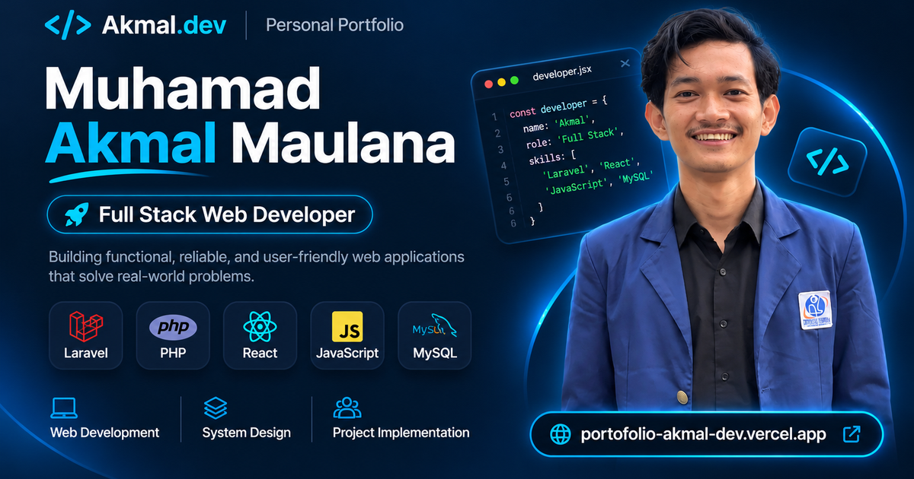

# Akmal.dev — Personal Portfolio

A modern, responsive, and interactive personal portfolio website built with React, Vite, and Framer Motion.

This portfolio showcases my technical skills, web development projects, professional experience, and certifications.

**Live Website:** [portofolio-akmal-dev.vercel.app](https://portofolio-akmal-dev.vercel.app/)

---

## About Me

Hi! I'm **Muhamad Akmal Maulana**, a Full Stack Web Developer passionate about building functional, reliable, and user-friendly web applications.

I enjoy transforming ideas into practical digital solutions, exploring modern web technologies, and solving real-world problems through code.

My development experience includes PHP, Laravel, React, JavaScript, HTML, CSS, and MySQL/MariaDB.

---

## Portfolio Preview



Explore the live portfolio:

**[Visit Akmal.dev](https://portofolio-akmal-dev.vercel.app/)**

---

## Tech Stack

### Portfolio Development

| Technology | Purpose |
|------------|---------|
| React | Component-based user interface |
| Vite | Development server and production build |
| JavaScript | Application logic and interactivity |
| HTML5 | Semantic page structure |
| CSS3 | Styling and responsive layouts |
| Framer Motion | Animations and transitions |
| Lucide React | Interface icons |
| React Icons | Technology and social media icons |

### Other Technical Skills

- PHP
- Laravel
- MySQL / MariaDB
- Git & GitHub
- Responsive Web Design
- REST API Integration
- Database Management

---

## Features

- Modern dark-themed interface with electric-blue accents
- Fully responsive layouts for desktop, tablet, and mobile
- Interactive animations powered by Framer Motion
- Custom developer-themed hero illustration
- About Me section with a professional profile photo
- Technical skills showcase
- Selected projects with repository and live-demo links
- Professional experience section
- Professional certification with PDF viewing and download
- Contact section with email and social media links
- Downloadable curriculum vitae
- SEO metadata and social sharing preview
- Deployment through Vercel

---

## Featured Project

### Ragen Swim Course

A full-stack web application developed to support swimming course operations.

The application includes functionality for:

- Class scheduling
- Participant bookings
- Booking confirmation and cancellation
- Booking rescheduling
- Waiting list management
- Participant package management
- Attendance tracking
- Session usage tracking
- Administrative booking management

**Technologies:** Laravel, PHP, MySQL/MariaDB

**Repository:** [Ragen Swim Course](https://github.com/NyxAkmall/ragen-swim-course)

**Live Website:** [ragenswimcourse.com](https://ragenswimcourse.com/)

---

## Getting Started

To run this portfolio locally, follow these steps.

### 1. Clone the Repository

```bash
git clone https://github.com/NyxAkmall/akmal-portfolio.git
```

### 2. Navigate to the Project

```bash
cd akmal-portfolio
```

### 3. Install Dependencies

```bash
npm install
```

### 4. Start the Development Server

```bash
npm run dev
```

Open the local URL displayed in your terminal, usually:

```text
http://localhost:5173
```

---

## Production Build

To generate a production-ready build:

```bash
npm run build
```

To preview the production build locally:

```bash
npm run preview
```

The generated files are stored in the `dist` directory.

---

## Project Structure

```text
akmal-portfolio/
├── public/
│   ├── projects/
│   ├── profile.jpg
│   ├── favicon.svg
│   ├── og-preview.png
│   ├── cv-akmal.pdf
│   └── sertifikat-bnsp-akmal.pdf
│
├── src/
│   ├── App.jsx
│   ├── App.css
│   ├── navbar.css
│   ├── TechnicalSkills.jsx
│   ├── SelectedProjects.jsx
│   ├── WorkExperience.jsx
│   ├── ProfessionalCertification.jsx
│   ├── ContactSection.jsx
│   ├── PortfolioFooter.jsx
│   └── main.jsx
│
├── index.html
├── package.json
├── vite.config.js
└── README.md
```

---

## Deployment

This portfolio is deployed using Vercel and connected to the GitHub repository for automatic deployment.

Updates pushed to the `main` branch can trigger a new production deployment.

**Website:** https://portofolio-akmal-dev.vercel.app/

---

## Contact

I'm open to opportunities involving web development, software development, and collaborative projects.

- **Email:** [akmalmaulana075@gmail.com](mailto:akmalmaulana075@gmail.com)
- **LinkedIn:** [Muhamad Akmal Maulana](https://www.linkedin.com/in/muhamad-akmal-maulana-dev/)
- **GitHub:** [NyxAkmall](https://github.com/NyxAkmall)
- **Portfolio:** [Akmal.dev](https://portofolio-akmal-dev.vercel.app/)

---

## Author

**Muhamad Akmal Maulana**

Full Stack Web Developer

Built with React, Vite, and Framer Motion.

© 2026 Muhamad Akmal Maulana.
